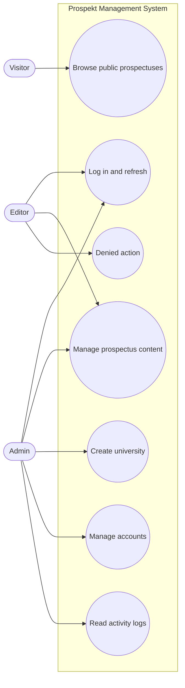
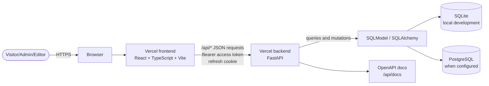
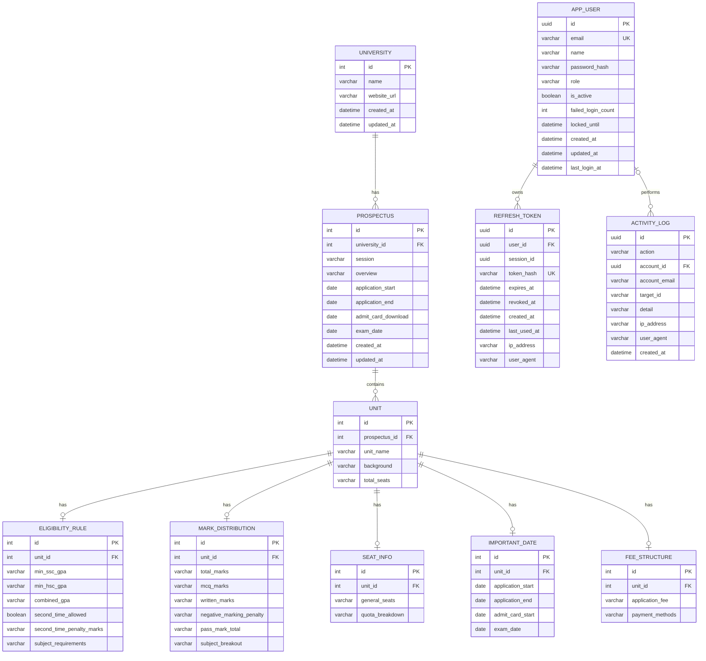
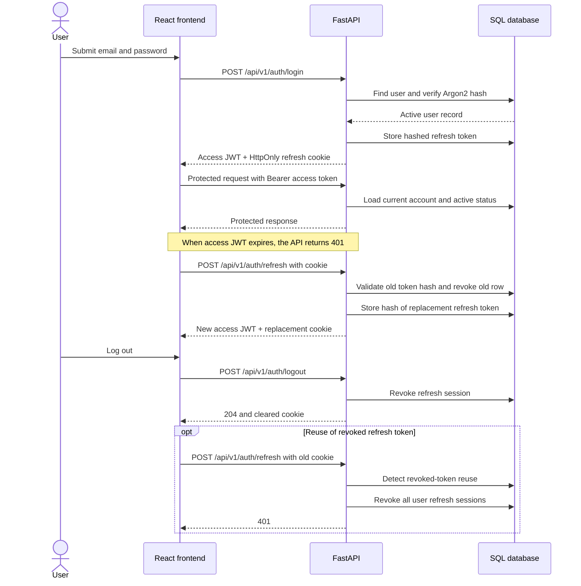
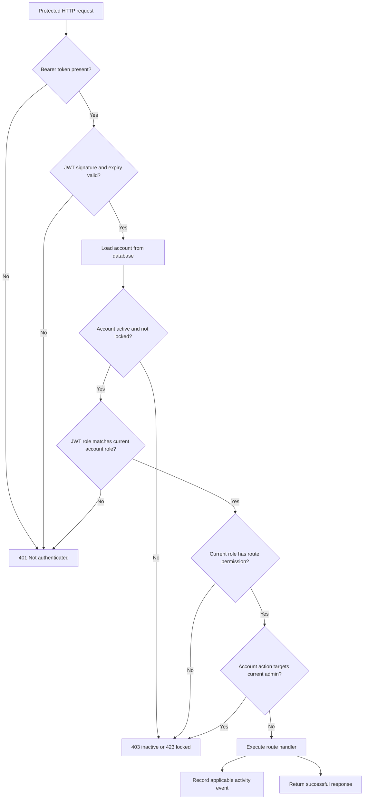
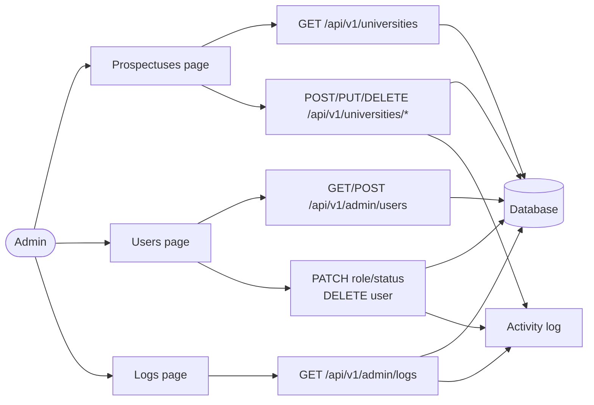
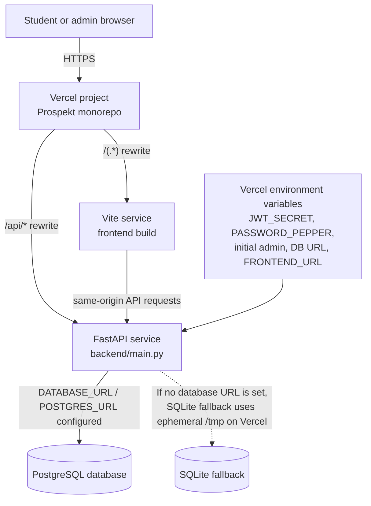
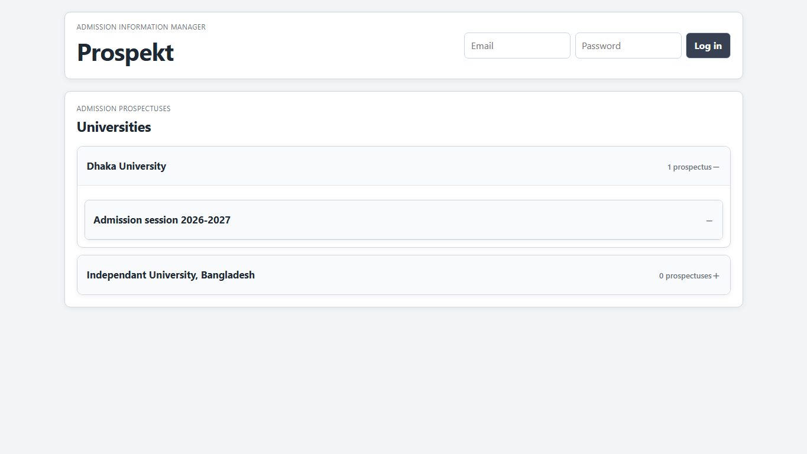
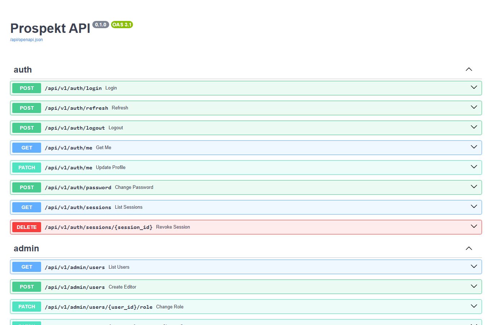

**Independent University, Bangladesh**  
**CSE309 Web Application & Internet**

**Final Project Submission Report**  
Submitted by:  
**Name**: Yeahia Ibne Rafiq  
**Student ID**: 2431059  
**Section**: 5  
**Team Number**: 27

**Project Title**: Prospekt  
**Vercel URL**: https://prospekt-beta.vercel.app/  
**GitHub Repository**: https://github.com/LDucky-2/Prospekt

**Submitted To**:  
**Sayef Reyadh**  
Adjunct Lecturer  
Department of Computer Science & Engineering  
Independent University, Bangladesh

Semester: Autumn 2026  
Date of Submission: 2026-11-28

# **Table of Contents**

1. [Executive Summary](#1-executive-summary)
2. [Part A. Product Requirements (PRD)](#part-a-product-requirements-prd)
3. [Part B. Software Requirements (SRS)](#part-b-software-requirements-srs)
4. [Part C. Technical Design (TDD)](#part-c-technical-design-tdd)
5. [Part D. Evidence](#part-d-evidence-screenshots-of-the-running-application)
6. [Part E. Project Management and Conclusion](#part-e-project-management-and-conclusion)
7. [Appendix](#appendix-test-accounts-and-video-demo)

## List of Figures and Screenshots

| Number | Caption | Section |
|---|---|---|
| Figure 1 | Prospectus Management System use-case diagram | B5 |
| Figure 2 | Prospekt system architecture | C2 |
| Figure 3 | Prospekt entity-relationship diagram | C4 |
| Figure 4 | Authentication and refresh-token sequence | C6 |
| Figure 5 | Server-side authorization flow | C7 |
| Figure 6 | Admin pages and API interactions | C8 |
| Figure 7 | Vercel deployment layout | C10 |
| S2 | Public prospectus page (deployed site) | D1 |
| S20 | Live OpenAPI documentation (deployed site) | D4 |
| S21 | Backend test output | D5 |

# **1. Executive Summary**

## **1.1 Project overview**

Prospekt is a structured university-admission prospectus platform for students and guardians in Bangladesh. It replaces dense, unit-mixed prospectus documents with browsable admissions sessions and university units containing eligibility rules, mark distributions, seat information, important dates, fees, and official links. The implementation uses React 19 with TypeScript and Vite for the frontend, FastAPI and SQLModel for the API, SQLite for local development or PostgreSQL in production, and Vercel for deployment.

## **1.2 What was built since the mid assessment**

- JWT authentication with short-lived access tokens and rotation-based refresh sessions.
- Role-based access control for editor and admin roles.
- Protected university and prospectus CRUD operations.
- An admin dashboard for account management and activity logs.
- Profile, password, refresh, logout, and refresh-session management.
- Argon2 password hashing and a deployment password pepper.
- Five-failure account lockout with a 15-minute lock period.
- Refresh-token reuse detection and session revocation.
- Server-side security headers and CORS restrictions.
- Vercel service rewrites for the frontend and FastAPI backend.

## **1.3 Live links**

**Table 1: Project links**

| Resource | URL | Verification |
|---|---|---|
| GitHub repository | https://github.com/LDucky-2/Prospekt | Verified repository remote |
| Vercel frontend | https://prospekt-beta.vercel.app/ | Verified reachable; displays public prospectus data |
| Public universities API | https://prospekt-beta.vercel.app/api/v1/universities | Public endpoint |
| API documentation | https://prospekt-beta.vercel.app/api/docs | Verified reachable |
| Video demo | Not provided | Still required for final submission |

# **Part A. Product Requirements (PRD)**

## **A1. Problem Statement**

University admissions in Bangladesh are commonly presented through large prospectus documents. Students and guardians must find eligibility, marks, seat counts, deadlines, fees, and application links across material that mixes several academic units and admissions sessions. The process is difficult on mobile devices and can lead to missed deadlines or incorrect interpretation.

Prospekt organizes this information by university, admissions session, and academic unit. It also provides authenticated content maintainers with a controlled interface for updating prospectus records.

## **A2. Users and Roles**

**Table 2: Users and roles**

| Role | Who they are | Main tasks | They must never be able to |
|---|---|---|---|
| Visitor | Anonymous student or guardian | Browse universities, sessions, units, eligibility, marks, seats, dates, fees, and official links | Create or edit content, manage accounts, or read protected account/log data |
| Editor | Authenticated content maintainer | Create, update, and delete prospectus content | Create universities or manage users and logs |
| Admin | Authenticated administrator | Manage prospectuses, editor/admin accounts, roles, status, and activity logs | Change or delete their own account through account-management routes |

## **A3. Goals and Success Measures**

**Table 3: Goals and measures**

| ID | Goal | Measurable success measure |
|---|---|---|
| G-1 | Provide public structured admission data | Anonymous `GET /api/v1/universities` and university-detail requests return 200 |
| G-2 | Preserve relational prospectus data | One university stores multiple sessions and each session stores multiple units |
| G-3 | Prevent unauthorized content changes | Missing authentication returns 401 and insufficient permissions return 403 |
| G-4 | Secure administrative sessions | Passwords use Argon2, access tokens expire in 15 minutes, refreshes rotate, and reuse is detected |
| G-5 | Provide audit accountability | Login, logout, account, role, status, password, university, and prospectus actions are logged |
| G-6 | Produce reproducible builds | 8 backend tests pass and the frontend production build succeeds |

## **A4. Scope and Non-Goals**

**In scope**

- Public university and prospectus browsing.
- Multiple admissions sessions per university.
- Multiple units per prospectus.
- Eligibility, marks, seats, dates, and fee data.
- JWT login, refresh, logout, profile, password, and session management.
- Editor and admin roles.
- User management, role/status changes, search, filtering, and activity logs.
- Vercel deployment configuration and OpenAPI documentation.

**Out of scope**

- Automated PDF upload and extraction.
- Public student signup or public user accounts.
- Password-reset email workflows.
- Unit comparison and browser bookmarks.
- CSV export and bulk administrative actions.
- CI/CD workflows and branch protection.
- Group and group-ownership features.

**Assumptions and constraints**

- SQLite is used for local development and PostgreSQL is the production target.
- The initial administrator is provisioned through environment variables.
- Production database and secret configuration belongs to the project owner.
- GPA and mark fields accept text because source prospectuses do not always provide a single numeric format.

## **A5. User Stories**

**Table 4: User stories**

| ID | Story |
|---|---|
| US-01 | As a visitor, I want to browse universities so that I can find relevant admissions information |
| US-02 | As a visitor, I want to open an admissions session and view its units |
| US-03 | As a visitor, I want to view eligibility, marks, seats, dates, and fees |
| US-04 | As a visitor, I want to open an official university website |
| US-05 | As an editor, I want to log in so that I can maintain prospectus content |
| US-06 | As an editor, I want to create and update prospectus records |
| US-07 | As an editor, I want mutation attempts denied unless permission is granted |
| US-08 | As an admin, I want to create editor accounts |
| US-09 | As an admin, I want to change account roles and active status |
| US-10 | As an admin, I want to search and filter activity logs |
| US-11 | As a user, I want to change my password |
| US-12 | As a user, I want to revoke an active refresh session |

# **Part B. Software Requirements (SRS)**

## **B1. Introduction**

This specification describes the implemented public prospectus interface and protected administration functions.

| Term | Meaning |
|---|---|
| JWT | JSON Web Token used as a short-lived access credential |
| Access token | HS256-signed token identifying `sub` and `role` |
| Refresh token | Opaque random credential whose SHA-256 hash is stored by the server |
| RBAC | Server-side role and permission authorization |
| Role | Editor or admin |
| Permission | A named prospectus, university, account, or log capability |
| Audit log | Stored security and administration event history |

**References:** [RFC 7519 (JSON Web Token)](https://www.rfc-editor.org/rfc/rfc7519), [FastAPI documentation](https://fastapi.tiangolo.com/), and [SQLModel documentation](https://sqlmodel.tiangolo.com/).

## **B2. Functional Requirements**

**Table 5: Authentication requirements**

| ID | Requirement |
|---|---|
| FR-AUTH-01 | The system shall authenticate email and password against Argon2 password hashes |
| FR-AUTH-02 | The system shall issue an HS256 access token containing `sub`, `role`, `iat`, and `exp` |
| FR-AUTH-03 | The default access-token lifetime shall be 15 minutes |
| FR-AUTH-04 | The system shall store only an SHA-256 hash of each refresh token |
| FR-AUTH-05 | The refresh cookie shall be HttpOnly and Strict, and Secure in Vercel deployments |
| FR-AUTH-06 | The system shall rotate refresh tokens on refresh |
| FR-AUTH-07 | The system shall revoke all sessions when refresh-token reuse is detected |
| FR-AUTH-08 | The system shall support logout and session revocation |
| FR-AUTH-09 | The system shall lock an account for 15 minutes after five failed login attempts |
| FR-AUTH-10 | The system shall allow profile-name updates and password changes |

**Table 6: RBAC requirements**

| ID | Requirement |
|---|---|
| FR-RBAC-01 | The system shall give editors prospectus create, update, and delete permissions |
| FR-RBAC-02 | The system shall give admins prospectus and university permissions plus account and log permissions |
| FR-RBAC-03 | The system shall reject missing or invalid access credentials with 401 |
| FR-RBAC-04 | The system shall reject insufficient permissions with 403 |
| FR-RBAC-05 | The system shall prevent an admin from changing or deleting itself through account-management routes |
| FR-RBAC-06 | The system shall reject inactive accounts from protected use |

**Table 7: Admin requirements**

| ID | Requirement |
|---|---|
| FR-ADM-01 | The system shall list users with search, role, status, offset, and limit parameters |
| FR-ADM-02 | The system shall create editor accounts |
| FR-ADM-03 | The system shall promote or demote accounts between editor and admin |
| FR-ADM-04 | The system shall activate or deactivate accounts |
| FR-ADM-05 | The system shall revoke sessions for a deactivated or deleted account |
| FR-ADM-06 | The system shall filter activity logs by text, action, and IP address |
| FR-ADM-07 | The system shall record administrative and authentication events |

**Table 8: Domain requirements**

| ID | Requirement |
|---|---|
| FR-DOM-01 | The system shall publicly list all universities |
| FR-DOM-02 | The system shall return a university with its admissions sessions |
| FR-DOM-03 | The system shall return each session with its units |
| FR-DOM-04 | The system shall expose eligibility, mark, seat, date, and fee structures |
| FR-DOM-05 | The system shall allow authorized creation, update, and deletion of prospectus records |
| FR-DOM-06 | The system shall expose health and OpenAPI endpoints |

## **B3. Non-Functional Requirements**

**Table 9: Non-functional requirements**

| ID | Category | Requirement |
|---|---|---|
| NFR-01 | Security | Production secrets shall come only from environment variables |
| NFR-02 | Security | Passwords shall never be stored or logged in plaintext |
| NFR-03 | Security | CORS shall allow only approved local origins and the configured frontend origin |
| NFR-04 | Security | Responses shall include no-sniff, frame-denial, referrer, and permissions-policy headers |
| NFR-05 | Persistence | Local data shall use SQLite and production shall support PostgreSQL |
| NFR-06 | Usability | The interface shall remain usable on mobile and desktop viewports |
| NFR-07 | API | Errors shall use JSON `detail` responses with correct HTTP status codes |
| NFR-08 | Maintainability | Role permissions shall remain centralized in the RBAC module |
| NFR-09 | Testing | Automated tests shall cover migration, security, RBAC, and nested prospectus data |

## **B4. Roles and Permission Matrix**

**Table 10: Endpoint groups by role**

| Capability | Visitor | Editor | Admin |
|---|---:|---:|---:|
| Public prospectus reads | Yes | Yes | Yes |
| University create | No | No | Yes |
| Prospectus create/update/delete | No | Yes | Yes |
| Account view/manage | No | No | Yes |
| Activity-log view | No | No | Yes |

**Table 11: Group permissions**

| Group feature | Prospekt implementation |
|---|---|
| Group permissions | Not applicable; Prospekt does not implement groups |

**Table 12: Admin rules**

| Rule | Implementation |
|---|---|
| Admin cannot change own role | Enforced server-side |
| Admin cannot deactivate or delete itself | Enforced server-side |
| No super-admin role | The implemented roles are only `editor` and `admin` |

## **B5. Use Cases**

1. **Log in and refresh**
   - Actor: editor or admin
   - Precondition: active account exists
   - Main flow: submit credentials, receive access token, store refresh cookie, refresh once when access expires
   - Alternative: invalid login 401, inactive account 403, or lockout 423

2. **Create a prospectus**
   - Actor: editor or admin
   - Main flow: open prospectus form, provide session and unit data, submit PUT/POST, receive nested record
   - Alternative: missing permission 403

3. **A denied action**
   - Actor: editor
   - Main flow: request university creation
   - Alternative: university-create permission is unavailable, so 403 is returned

4. **Manage an account**
   - Actor: admin
   - Main flow: search for account, change role/status or delete account
   - Alternative: target is the current admin, so 403 is returned

5. **Read activity logs**
   - Actor: admin
   - Main flow: open Logs page, apply search/action/IP filters, receive paginated data
   - Alternative: editor lacks log permission and receives 403

**Table 13: Use case descriptions**

| Use case | Actor | Preconditions and main flow | Alternative/error flow | Postcondition |
|---|---|---|---|---|
| UC-01: Login and refresh | Editor/Admin | Active account; submit credentials, receive access token and refresh cookie; refresh on expiry | 401 invalid credentials, 403 inactive account, 423 locked account | Authenticated session exists; refresh token is rotated |
| UC-02: Create prospectus | Editor/Admin | Authenticated user selects university, fills session/unit data, submits form | 401 unauthenticated, 403 permission denied, 404 unknown university, 422 invalid payload | Prospectus and nested units are persisted |
| UC-03: Update/delete prospectus | Editor/Admin | Authenticated user selects a prospectus and submits an update or confirms deletion | 401 unauthenticated, 403 permission denied, 404 unknown record | Record is updated or removed; activity event is recorded |
| UC-04: Create university | Admin | Admin submits university name and optional website | 401 unauthenticated, 403 editor denied, 422 invalid payload | University is persisted and action is logged |
| UC-05: Manage account | Admin | Admin searches users, then creates, changes role/status, or deletes another account | 403 self-change denied, 404 unknown account, 409 duplicate email | Account change is persisted and logged |
| UC-06: Read activity logs | Admin | Admin opens Logs and optionally filters search/action/IP | 401 unauthenticated, 403 editor denied | Matching log entries are displayed |

**Figure 1: Prospekt Management System use-case diagram**



## **B6. Acceptance Criteria**

**Table 14: Acceptance criteria**

| ID | Requirement | Given | When | Then |
|---|---|---|---|---|
| AC-01 | FR-AUTH-02 | Token is expired or tampered | Protected request is sent | Request is rejected |
| AC-02 | FR-RBAC-04 | Editor lacks university-create permission | Editor creates university | 403 returned |
| AC-03 | FR-AUTH-09 | Five failed attempts occur | Account is tried again | 423 returned during lockout |
| AC-04 | FR-AUTH-07 | A refresh token is revoked | Token is reused | Session family is revoked |
| AC-05 | FR-RBAC-05 | Admin targets itself | Role/status/deletion is requested | 403 returned |
| AC-06 | FR-DOM-01 | Database contains universities | Visitor lists universities | 200 response is returned |

## **B7. Traceability Matrix**

**Table 15: Requirement traceability**

| Requirement | Endpoint or screen | Automated test | Evidence |
|---|---|---|---|
| FR-DOM-02/03 | University detail response | `test_university_contains_multiple_prospectuses_with_nested_units` | Passed |
| FR-AUTH-02/03 | Access-token verification | `test_expired_access_token_is_rejected` | Passed |
| FR-RBAC-02 | University create route | `test_editor_cannot_create_universities` | Passed |
| FR-RBAC-01/02 | Protected mutation permissions | `test_editor_has_prospectus_permissions_but_not_account_permissions` | Passed |
| FR-DOM-04 | Prospectus/unit schemas | `test_string_fields_accept_non_numeric_text` | Passed |
| FR-ADM-01/06 | Users and Logs pages | No UI integration test exists | S11/S15 screenshots required |

# **Part C. Technical Design (TDD)**

## **C1. Technology Stack**

**Table 16: Technology stack**

| Component | Technology | Reason |
|---|---|---|
| Frontend | React 19, TypeScript, Vite | Responsive application interface |
| Backend | FastAPI | API routing, validation, OpenAPI |
| ORM | SQLModel/SQLAlchemy | Relational models and persistence |
| Local database | SQLite | Zero-configuration development |
| Production database | PostgreSQL | Intended persistent serverless database |
| Password hashing | pwdlib/Argon2 | Strong password storage |
| JWT | PyJWT/HS256 | Access-token signing |
| Refresh token | Random opaque token/SHA-256 | Revocable server sessions |
| Testing | pytest | Backend regression tests |
| Hosting | Vercel | Unified frontend and API deployment |

## **C2. System Architecture**

**Figure 2: Prospekt system architecture**



The browser sends JSON and credentials to same-origin `/api/*` paths. Protected requests include a bearer access token. Refresh requests include the HttpOnly refresh cookie. FastAPI verifies and authorizes the request before querying or mutating SQLModel data.

## **C3. Backend and Frontend Structure**

```text
backend/
  main.py
  app/
    config.py
    database.py
    errors.py
    activity/
    admin/
    auth/
    rbac/
    universities/
  tests/
```

The backend has route modules, SQLModel models/repositories, authentication services, centralized permissions, and activity recording.

```text
frontend/
  src/
    App.tsx
    index.css
    main.tsx
    services/
      api.ts
```

`App.tsx` contains public browsing, login, editor/admin pages, and forms. `api.ts` owns access-token state, refresh behavior, and HTTP calls.

## **C4. Data Model**

**Core hierarchy:** `University -> Prospectus -> Unit -> EligibilityRule/MarkDistribution/SeatInfo/ImportantDate/FeeStructure`.

**Security hierarchy:** `AppUser -> RefreshToken` and `AppUser/target -> ActivityLog`.

The user model stores UUID, email, name, password hash, role, active status, failed-login count, lockout time, and timestamps. Refresh sessions store the user, session UUID, SHA-256 token hash, expiry, revocation time, IP, user-agent, and timestamps.

**Figure 3: Prospekt entity-relationship diagram**



In the diagram, one-to-one unit detail relationships have unique `unit_id` constraints. Activity rows may have a null `account_id` for anonymous events. Role and action values are enums in application code.

## **C5. API Design**

| Method | Path | Authentication/Role | Success | Errors |
|---|---|---|---:|---|
| GET | `/api/v1/universities` | Public | 200 | 500 |
| GET | `/api/v1/universities/{id}` | Public | 200 | 404, 500 |
| POST | `/api/v1/universities` | Admin | 201 | 401, 403, 422 |
| PUT | `/api/v1/universities/{id}` | Prospectus update | 200 | 401, 403, 404 |
| DELETE | `/api/v1/universities/{id}` | Prospectus delete | 204 | 401, 403, 404 |
| POST | `/api/v1/universities/{id}/prospectuses` | Prospectus create | 201 | 401, 403, 404, 422 |
| PUT | `/api/v1/universities/{id}/prospectuses/{id}` | Prospectus update | 200 | 401, 403, 404, 422 |
| DELETE | `/api/v1/universities/{id}/prospectuses/{id}` | Prospectus delete | 204 | 401, 403, 404 |
| POST | `/api/v1/auth/login` | Public | 200 | 401, 403, 423 |
| POST | `/api/v1/auth/refresh` | Refresh cookie | 200 | 401 |
| POST | `/api/v1/auth/logout` | Authenticated | 204 | 401 |
| GET/PATCH | `/api/v1/auth/me` | Authenticated | 200 | 401 |
| POST | `/api/v1/auth/password` | Authenticated | 204 | 400, 401 |
| GET | `/api/v1/auth/sessions` | Authenticated | 200 | 401 |
| DELETE | `/api/v1/auth/sessions/{session_id}` | Authenticated | 204 | 401, 404 |
| GET | `/api/v1/admin/users` | Admin | 200 | 401, 403 |
| POST | `/api/v1/admin/users` | Admin | 201 | 401, 403, 409, 422 |
| PATCH | `/api/v1/admin/users/{user_id}/role` | Admin | 200 | 401, 403, 404, 422 |
| PATCH | `/api/v1/admin/users/{user_id}/status` | Admin | 200 | 401, 403, 404 |
| DELETE | `/api/v1/admin/users/{user_id}` | Admin | 204 | 401, 403, 404 |
| GET | `/api/v1/admin/logs` | Admin | 200 | 401, 403 |
| GET | `/api/health` | Public | 200 | 500 |

The API-version prefix is `/api/v1`. Errors use `{"detail":"message"}`.

## **C6. JWT Authentication Design**

Login verifies the Argon2 hash, creates a 15-minute HS256 access token, creates an opaque refresh token, persists its hash, and sets the refresh cookie. Protected requests verify signature, expiry, account existence, active status, and role.

The access token contains `sub`, `role`, `iat`, and `exp`. It is stored in `sessionStorage`. The refresh token is HttpOnly and SameSite=Strict, with Secure enabled on Vercel. On a 401, the frontend refreshes once and retries once.

**Table: Token claims**

| Claim | Meaning |
|---|---|
| `sub` | Account UUID |
| `role` | `editor` or `admin` |
| `iat` | Issued-at time |
| `exp` | Expiry time |

**Figure 4: Login, protected request, refresh, logout, and reuse sequence**



## **C7. RBAC Design**

A protected request is authorized in this order: access token, current user lookup, active-status check, role permission lookup, and route handler. The central permission module contains a reusable dependency used by university, prospectus, account, and log routes.

```python
def require_permission(permission: Permission) -> Callable[..., AppUser]:
    def check(user: CurrentUser) -> AppUser:
        if permission not in ROLE_PERMISSIONS.get(user.role, set()):
            raise HTTPException(status_code=403, detail="Permission denied")
        return user
    return check
```

Editors receive prospectus create/update/delete permissions. Admins receive those permissions plus university, user-management, and log permissions.

**Figure 5: Server-side authorization flow**



The self-target check applies only to account-management actions. Public reads do not pass through this protected-route flow.

## **C8. Admin Dashboard Design**

The prospectus page supports university/prospectus browsing and edit forms. The Users page provides search, role/status filters, account creation, role/status changes, and deletion. The Logs page provides text, action, and IP filters.

Administrative actions write activity records for account creation/deletion, role changes, status changes, login/logout, password changes, university changes, and prospectus changes.

The current implementation does not provide bulk actions or CSV export.

**Figure 6: Admin pages and API interactions**



## **C9. Security Design and Threats**

**Table: Threats, defences, and code locations**

| Threat | Defence | Location |
|---|---|---|
| Password database leak | Argon2 plus deployment pepper | `app/auth/security.py` |
| Stolen access token | 15-minute expiry and server verification | Auth service/security |
| Stolen refresh token | HttpOnly cookie and hashed database storage | Auth router/service |
| Cross-site scripting | Refresh token is HttpOnly; the access token in `sessionStorage` remains exposed to same-origin script execution | Auth cookie and frontend API client |
| Refresh reuse | Revoke the user's refresh-session family | `AuthService.refresh` |
| Brute force | Five failures trigger a 15-minute lock | `AuthService.login` |
| Privilege escalation | Server-side permission dependencies | `app/rbac` |
| Access to another user's refresh session | Session listing and revocation queries include the authenticated `user_id` | `AuthRepository` |
| Cross-site request forgery | Strict SameSite cookie | Auth cookie configuration |
| CORS misuse | Explicit local/frontend origins | `main.py` |
| SQL injection | SQLModel/SQLAlchemy parameterized operations | Repositories |
| Over-posting | Separate validated request schemas and route-level permissions | `app/*/schemas.py`, routers |
| Secrets in repository | Environment variables | `app/config.py` and `.env.example` |

## **C10. Deployment on Vercel**

`vercel.json` declares FastAPI and Vite services, rewrites `/api/*` to the backend, and sends remaining requests to the frontend. Production requires PostgreSQL or another supported PostgreSQL URL, JWT and pepper secrets, initial-admin variables, the frontend origin, and token lifetimes.

Environment variables: `DATABASE_URL`, `POSTGRES_URL`, `JWT_SECRET`, `PASSWORD_PEPPER`, `ACCESS_TOKEN_MINUTES`, `REFRESH_TOKEN_DAYS`, `INITIAL_ADMIN_EMAIL`, `INITIAL_ADMIN_PASSWORD`, `INITIAL_ADMIN_NAME`, `FRONTEND_URL`, and Vercel's `VERCEL` indicator.

**Figure 7: Vercel deployment layout**



The repository configures the Vercel services and rewrites. The live frontend and API docs were reachable when this report was prepared. The production database provider and Vercel environment-variable values were not accessible from the repository and have not been independently confirmed.

## **C11. Testing**

Backend command:

```powershell
cd backend
.\.venv\Scripts\python.exe -m pytest
```

Frontend command:

```powershell
cd frontend
npm run build
```

**Table: Tests and results**

| Test | Requirement | Result |
|---|---|---|
| Missing/tampered token | FR-AUTH-02 | Passed |
| Expired token | FR-AUTH-03 | Passed |
| Editor cannot create universities | FR-RBAC-02 | Passed |
| Admin can create universities | FR-RBAC-02 | Passed |
| Editor has only prospectus/account limits | FR-RBAC-01/06 | Passed |
| Text-valued admission fields | FR-DOM-04 | Passed |
| Nested prospectus migration/data | FR-DOM-02/03 | Passed |
| Migration SQL test | Persistence | Passed |
| Frontend production build | Frontend build | Passed |

# **Part D. Evidence: Screenshots of the Running Application**

Screenshots S2 and S20 were captured from the supplied deployed Vercel URL. The remaining items are identified below according to whether the current UI implements them and whether external account access is needed. Passwords and tokens must be masked in any additional captures.

## **D1. User Side**

- **S1:** Signup is not implemented. The deployed page includes login fields, but a signup-validation screenshot is therefore not applicable.
- **S2:** Public university and admissions-session list, captured from the deployed site:



The captured image shows the application viewport; the browser toolbar is not included in this automated capture.

- **S3:** Profile and change-password routes exist in the API, but the current frontend has no profile/password form.
- **S4:** Session list/revoke routes exist in the API, but the current frontend has no session-management UI.
- **S5:** The Users and Logs screens require admin credentials and are not captured here.
- **S6:** A live RBAC denial screenshot requires an editor account, which was not provided.

## **D2. Security Behaviour**

- **S7:** Not captured; requires an authenticated account and browser developer tools.
- **S8:** Not captured; requires an authenticated account and browser developer tools.
- **S9:** Not captured; requires an authorized admin to deactivate an account.

## **D3. Admin Dashboard**

- **S10:** No dashboard statistics overview is implemented; the public Prospekt content page is shown in S2.
- **S11:** Users list with search and role/status filters. The current UI does not expose pagination controls.
- **S12:** No dedicated user-detail page is implemented.
- **S13:** Deactivate-account action and resulting state; requires a project admin account for capture.
- **S14:** Prospectus records and CRUD action; requires an editor/admin account for capture.
- **S15:** Activity logs with search/action/IP filters; requires a project admin account for capture.
- **S16:** No separate security dashboard exists. Login/security events appear in the Logs page.
- **S17:** CSV export — not applicable; CSV export is not implemented.

## **D4. Deployment**

- **S18:** Vercel frontend project and production domain; requires access to the project owner's Vercel account.
- **S19:** Vercel environment-variable names with values hidden; requires access to the project owner's Vercel account.
- **S20:** Live API documentation page, captured from the deployed site:



## **D5. Tests**

- **S21:** Automated backend test result:

```text
============================= test session starts =============================
collected 8 items
tests\test_migrations.py .                                               [ 12%]
tests\test_security.py ......                                            [ 87%]
tests\test_university_prospectuses.py .                                  [100%]
============================== 8 passed in 9.82s ==============================
```

# **Part E. Project Management and Conclusion**

## **E1. How to Run and Test**

Prerequisites: Python 3.11 or newer, Node.js/npm compatible with Vite 8, and Git. From a fresh clone, install backend and frontend dependencies:

```powershell
cd backend
python -m venv .venv
.\.venv\Scripts\python.exe -m pip install -r requirements.txt
.\.venv\Scripts\python.exe -m pytest
.\.venv\Scripts\fastapi.exe dev main.py
```

In a second terminal:

```powershell
cd frontend
npm ci
npm run dev
npm run build
```

Use [`backend/.env.example`](../backend/.env.example) for variable names. Leave database URL unset for local SQLite, or provide a PostgreSQL connection string. Production must use generated `JWT_SECRET` and `PASSWORD_PEPPER` values; the initial admin account is created from `INITIAL_ADMIN_EMAIL`, `INITIAL_ADMIN_PASSWORD`, and `INITIAL_ADMIN_NAME`. Never commit actual secrets. Log in using the initial admin credentials configured by the project owner; credentials are not included in this repository.

## **E2. GitHub Work**

The project has one team member: Yeahia Ibne Rafiq.

**Table: Issues, pull requests, and delivered work**

| Link/Number | Title | Delivered |
|---|---|---|
| Not supplied | Student will add issue/PR links later | No links could be verified from local Git metadata |

Recent implementation work is visible in Git history; issue and pull-request links could not be supplied from the repository.

## **E3. Limitations**

- The live public frontend and API documentation were reachable during report preparation.
- Production database provider and status are not documented in the repository.
- The public page and API-doc screenshots are captured; authenticated account and Vercel-console screenshots remain unavailable.
- The video demo is unavailable.
- The public signup evidence and normal-user screenshots do not apply because public signup is not in scope.
- CSV export and bulk actions are not implemented.
- PDF extraction is not implemented.
- Unit comparison and bookmarks are not implemented.
- CI/CD and branch protection are not configured.

## **E4. Future Work**

| Priority | Work | Reason |
|---|---|---|
| 1 | Configure production database and verify deployment | Required for persistent live operation |
| 2 | Capture remaining authenticated/console screenshots and record demo | Required for final submission evidence |
| 3 | Add integration/API tests | Verify live auth and RBAC flows |
| 4 | Add PDF parsing or controlled import | Reduce manual prospectus entry |
| 5 | Add public search/filtering | Improve discovery |
| 6 | Add CI/CD and branch protection | Prevent regressions |
| 7 | Add unit comparison/bookmarks | Improve student comparison |

## **E5. Sources, Libraries and Tools**

**Table: Sources, libraries, and tools**

| Name/Version or link | Use |
|---|---|
| [React 19](https://react.dev/) | Frontend UI |
| [TypeScript](https://www.typescriptlang.org/) 7 | Frontend types |
| [Vite](https://vite.dev/) 8 | Frontend build/dev server |
| [FastAPI](https://fastapi.tiangolo.com/) (`>=0.141.1`) | Backend API |
| [SQLModel](https://sqlmodel.tiangolo.com/) (`>=0.0.22`) and SQLAlchemy | Models and database access |
| [SQLite](https://www.sqlite.org/docs.html) / [PostgreSQL](https://www.postgresql.org/docs/) | Local/production persistence |
| [Psycopg](https://www.psycopg.org/), `psycopg[binary] >=3.2` | PostgreSQL driver |
| [PyJWT](https://pyjwt.readthedocs.io/) (`>=2.10`) | JWT creation and verification |
| [pwdlib](https://github.com/frankie567/pwdlib) with Argon2 (`>=0.3`) | Password hashing |
| [pytest](https://docs.pytest.org/) (`>=8.0`) | Backend tests |
| [Vercel](https://vercel.com/docs) | Deployment |
| [GitHub](https://github.com/LDucky-2/Prospekt) | Repository and version control |
| Copilot SDK in VS Code | AI assistance for implementation and documentation; generated changes were checked against project code and test/build output |

# **Appendix. Test Accounts and Video Demo**

The video-demo link is unavailable in the repository.

Test account IDs and passwords are intentionally excluded from this Markdown report and repository. Add demo credentials only to the private Appendix of the submitted PDF, with at least the required admin/editor demo accounts and no plain passwords in GitHub.

[image1]: <>
